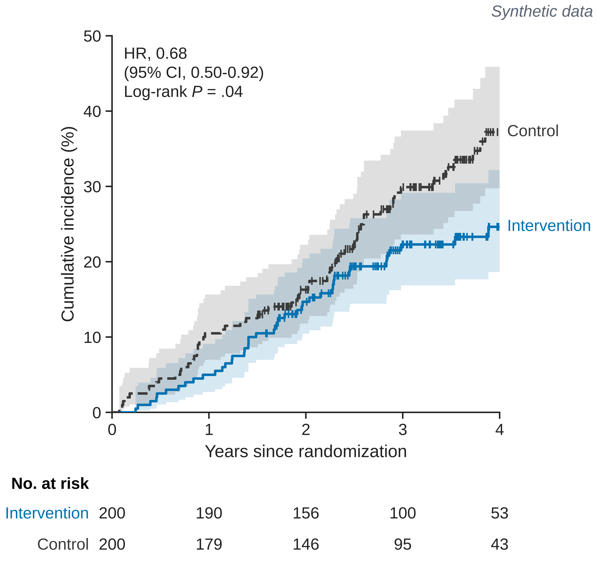
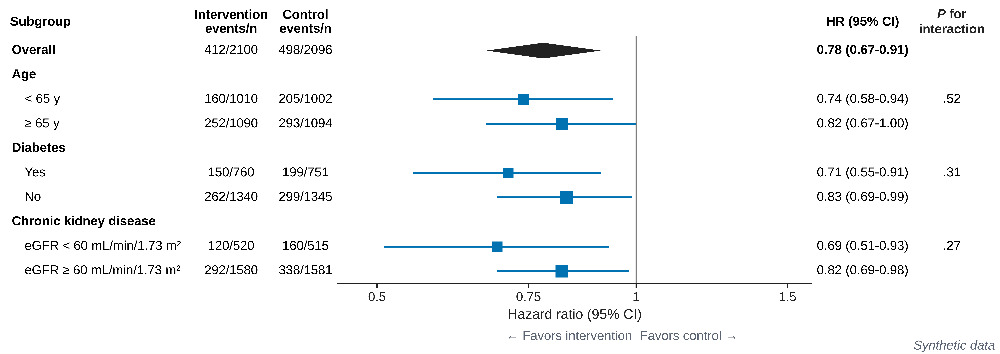
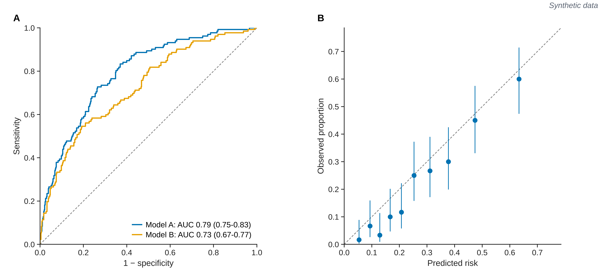

# scientific-figure-publication

A Claude skill (and Claude Code plugin) for building, polishing, and checking scientific figures at the size a journal prints them. It turns data into submission-ready charts, clinical figures, diagrams, and image panels; applies verified size, type, resolution, and statistics-style rules for 42 journals and venues; and runs an automated quality gate before anything is delivered. It merges and audits three open repositories (Scientific-Figure-Design, polish-sci-figures, figures4papers) and corrects the defaults that failed color-vision and final-size checks.







All gallery data are synthetic and labeled as such in the artwork.

## What it does

- Final-size figures: fixed physical canvases, type and stroke sizes checked against the target, no tight bounding boxes, TrueType fonts embedded, live SVG text.
- Journal presets transcribed from official author instructions for Nature, Science, Cell, PNAS, JAMA, NEJM, The Lancet, BMJ, Annals, JACC and the JACC family, AHA journals, EHJ, JVS, EJVES, JEVT, Vascular Medicine, IEEE, NeurIPS, ICML, ICLR, CVPR, ACL, ACM, and more, each with quotes, URLs, and a retrieval date (2026-11-14).
- Clinical builders: Kaplan-Meier and Aalen-Johansen curves with numbers at risk and journal truncation rules, log-rank tests, forest plots (standalone or as one panel of a larger figure), CONSORT 2025 and PRISMA 2020 flow diagrams with count checks, Bland-Altman, ROC with DeLong intervals, calibration, waterfall, and spaghetti plots.
- Color: Okabe-Ito categorical order checked under simulated protanopia, deuteranopia, and tritanopia (Machado 2009) with CIEDE2000; perceptually uniform and centered diverging colormaps.
- Statistics house styles: AMA, NEJM, Annals, Lancet, EHJ, EJVES, JEVT, Vascular Medicine, and AHA P-value and interval formats, plus a legend checker with journal word limits.
- Diagrams: an editable draw.io pipeline and an SVG icon composer with 619 licensed icons, including a clinical set.
- Image panels: batch-locked display settings, calibrated scale bars, identifier masking, audit hashes, and duplicate screening as review leads.
- Integrity rules: never invent or alter data, never refit model estimates from display data, flag claims the data contradict, and mark conflicting inputs for confirmation.

## Install

Claude Code, as a plugin:

```
/plugin marketplace add SanjaySrivatsa5172/scientific-figure-publication
/plugin install scientific-figure-publication@scientific-figure-publication
```

Claude Code, as a personal skill:

```bash
git clone https://github.com/SanjaySrivatsa5172/scientific-figure-publication ~/.claude/skills/scientific-figure-publication
```

Claude apps (claude.ai, desktop): download `scientific-figure-publication.zip` from the repository's Releases page and upload it as a custom skill, following Anthropic's help article "Use skills in Claude". The zip holds one folder named after the skill, as that article requires.

Invoke it with `/scientific-figure-publication`, or ask for any figure, graph, chart, legend, or figure check.

## Requirements

Python 3.10 or later with numpy, matplotlib 3.7 or later (3.10 or later for subfigure panels), and Pillow; scipy is recommended (`pip install -r requirements.txt`). Optional tools extend the checks: pypdf or poppler (`pdffonts`, `pdfimages`, `pdftoppm`) for PDF audits and previews, cairosvg for SVG previews, Ghostscript for EPS previews, LibreOffice for rendering manuscripts, and the draw.io desktop app for diagram export. The skill reports which tools are missing instead of failing silently.

## What it runs, sends, and fetches

The skill runs its Python scripts on your machine and writes figures, previews, and reports into your project. It sends no data anywhere and collects no telemetry. It reads no credentials or environment tokens. Three scripts touch the network, and only when you ask for that task:

- `scripts/collect_arxiv_figures.py` downloads arXiv abstract pages and figure images (arxiv.org) for corpus mining.
- `assets/paper-icons/scripts/fetch_icon.py` downloads a named Lucide icon (raw.githubusercontent.com) and adds it to the local icon catalog.
- `assets/paper-icons/scripts/import_ml_paper_icons.py`, a maintenance script, lists and downloads an open icon set through the GitHub API (api.github.com, raw.githubusercontent.com).

Local tools it may call when installed: poppler, Ghostscript, LibreOffice, cairosvg, rsvg-convert, and the draw.io desktop command line.

## Verification

- 54 automated tests: the 17 upstream Scientific-Figure-Design tests and 37 toolkit tests, including Kaplan-Meier, Greenwood standard errors, and log-rank values checked against hand calculation and lifelines, AUC and DeLong values checked against scikit-learn, color-vision simulation checked against colorspacious, and CIEDE2000 checked against the Sharma test pairs. Run `python -m unittest discover -s tests`.
- `python scripts/demo_gallery.py --target <preset>` renders the ten gallery figures and audits them; the gallery passes the automated gate under most presets, and the failures that remain (for example at Vascular Medicine's 16 to 18 pt type) are real redesign needs, not tool errors.
- Eval cases for `claude plugin eval` are in `evals/`.

## Handoff to a manuscript drafting bot

The skill can act as the figure lane of a manuscript drafting bot: a request comes in as JSON and `scripts/figure_packet.py` returns `figure_packet.json` with the files, legend, callout, palette digest, QA verdict, and stated limits. See `references/manuscript-bot.md`.

## Limitations

- Journal instructions change. Recheck the live author guide before a real submission and record its URL and date with the files.
- The automated gate checks geometry, fonts, color, files, and journal chart rules; it cannot verify that a figure's claim is true, and it is not a statistical review.
- Figures are not final until the required font (Arial for most presets) is installed; the skill names any substitute it used.

## Credits and licenses

MIT License (see `LICENSE`). Built from Scientific-Figure-Design (MIT) and polish-sci-figures (MIT), whose code and rules are adapted with credit, and figures4papers (CC BY-NC 4.0), whose ideas are re-implemented without copying code. Bundled icons keep their own licenses: Lucide (ISC), Tabler (MIT), Phosphor (MIT), and Lobe icon code (MIT; brand marks remain trademarks of their owners). Details are in `THIRD_PARTY_NOTICES.md` and `references/audit-of-sources.md`.
